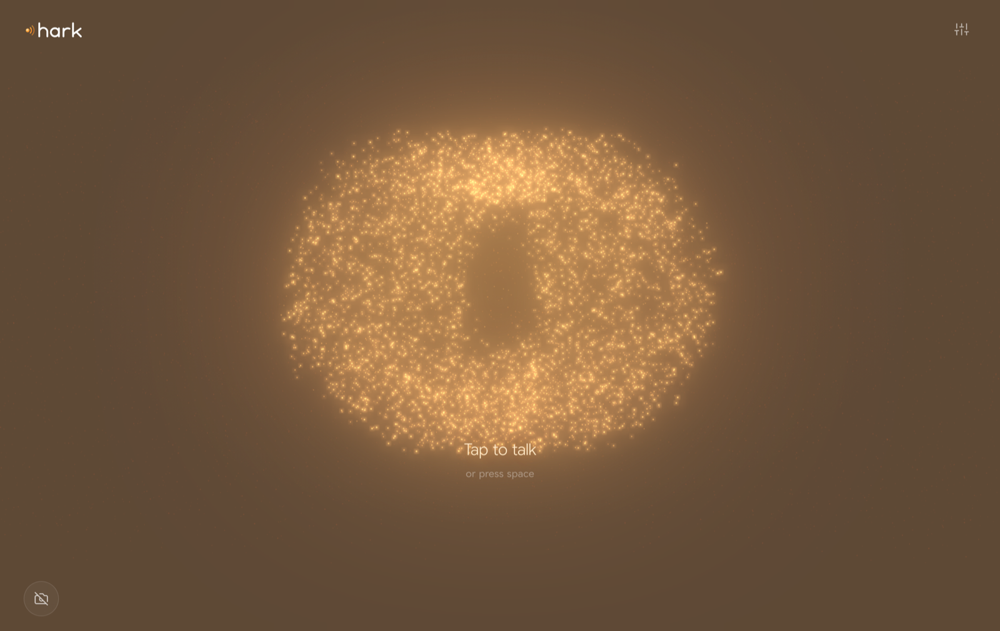
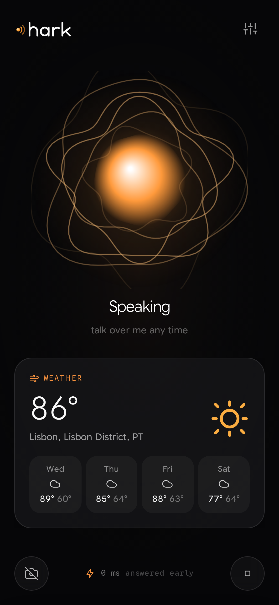

<p align="center">
  <picture>
    <source media="(prefers-color-scheme: dark)" srcset="docs/brand/hark-wordmark.svg">
    
  </picture>
</p>

<p align="center"><b>A voice you talk to. There is no chat box.</b><br>
It listens, thinks, and answers out loud, and every word is heard, thought, and spoken on <i>your own</i> Cloudflare account.</p>

<p align="center">
  <a href="https://hark.coey.dev">hark.coey.dev</a> ·
  <a href="#what-happens-when-you-talk">How it works</a> ·
  <a href="#built-on-cloudflare">Built on Cloudflare</a> ·
  <a href="#deploy">Deploy</a> ·
  <a href="#proof">Proof</a> ·
  <a href="#limits">Limits</a>
</p>



You open it and tap the ear (or press space). From then on you just talk. hark knows when you have finished a thought, often before you do, and starts answering in a voice. Talk over it and it stops. Ask it what is in front of you and it looks through your camera. Ask it for a picture and one appears. Say goodbye and it closes the microphone.

The only things on screen are the ear, which moves with your voice and with its own, and the cards it chooses to show you: the weather, a picture it painted, a timer, what it just remembered. There is no transcript and nowhere to type.

hark is one Cloudflare Worker. Each person gets a [Durable Object](https://developers.cloudflare.com/durable-objects/) that holds their voice line, memory, and timers. You sign in with your Cloudflare account, exactly as with [coil](https://github.com/acoyfellow/coil), and every model call runs on your Workers AI through your own [AI Gateway](https://developers.cloudflare.com/ai-gateway/). hark has no model bill of its own.



## What happens when you talk

```
mic ─▶ AudioWorklet: 16 kHz PCM, 80 ms frames ─▶ WebSocket ─▶ your Durable Object
                                                                   │
                     ┌─────────────── your AI Gateway ─────────────┤
                     ▼                                             │
     Deepgram Flux (WebSocket)  StartOfTurn · EagerEndOfTurn · TurnResumed · EndOfTurn
                     │
       EagerEndOfTurn ─▶ start thinking now, hold the audio behind a gate
       TurnResumed    ─▶ throw that away, keep listening
       EndOfTurn      ─▶ same words? open the gate : start over
                     │
     Workers AI brain (streamed, with tools) ─▶ sentence chunker ─▶ Aura 1 or 2, 3 in flight, streamed
                     │                                                    │
                     └─ tools: weather, look up, timers, memory, camera, paint, voice, sleep
                                                                          ▼
                     speaker ◀─ AudioWorklet ring buffer ◀─ 24 kHz PCM, tagged with its turn
```

- **It starts before you finish.** Flux sends `EagerEndOfTurn` when it thinks you are probably done. hark starts the model and the voice right then, but holds every byte of audio behind an [Effect](https://effect.website) `Deferred`. If you keep talking (`TurnResumed`), that work is interrupted and thrown away. If Flux confirms the same words (`EndOfTurn`), the gate opens and the first sentence is often ready already. The corner of the screen shows the real number: milliseconds from the moment Flux decided you were done to the first audio hark sent.
- **You can talk over it.** When you start speaking while it talks, it ducks its own volume at once. If what you say turns out to be words and not a cough, the turn's fiber is interrupted, the model request is aborted (so your account stops paying for tokens nobody will hear), and the browser drops everything already queued. What it had said so far goes into its memory of the conversation, marked as cut off.
- **It speaks in sentences, in order.** The reply streams from the model into a chunker that cuts the first piece early, at a comma if need be, so the voice starts fast. Later pieces are longer, so they sound natural. Up to three sentences are synthesized at once. Each one streams to your speaker as its audio arrives, and they always play in order.
- **The browser says when it has finished speaking.** Audio arrives faster than it plays. The playback worklet reports when its buffer runs dry, and only then does hark go back to listening.

## What it can do

| Ask | What happens | Runs on |
| --- | --- | --- |
| "What's the weather in Lisbon?" | A forecast card, and a spoken answer | [Open-Meteo](https://open-meteo.com) |
| "Who was Ada Lovelace?" | A card with the article, and a short spoken answer | Wikipedia |
| "Set a timer for ten minutes for the pasta" | A live countdown. When it ends, hark says so, even mid-silence | Durable Object alarm |
| "Remember that I take my coffee black" / "Forget that" | Saved to, or deleted from, your own memory | Durable Object SQLite |
| "What am I holding?" (camera on) | It takes one frame and a vision model describes it, so any brain can see | Gemma 4 vision, your account |
| "Paint me a lighthouse in a storm" | The picture appears on your screen | FLUX.2 klein, your account |
| "Talk like a man" / "Use the Orion voice" | It switches voice mid-conversation | Aura, your account |
| "Thanks, that's all" | It says goodbye and closes the microphone | |
| "Scaffold a node project and run it" | It works in your own durable Linux computer and shows a terminal card. `/workspace` survives restarts | Containers, on your Durable Object |
| "Search the web for what's new in Workers" | A sources card and a short spoken answer | Web search from your computer |
| "Open example.com" | A browser card with a screenshot or the page text | Browser Rendering on your token, or your computer |
| "Give me a status report on my account" | It calls the Cloudflare API with your sign-in and shows a report card. It asks before it deletes or changes anything | Cloudflare API, your token |
| "Build me a 3D rocket" | It sculpts the object from parts in the embers and spins it | Your browser |
| "Make that your resting shape" | The swarm loops it whenever nothing else is showing | Durable Object SQLite |

## Built on Cloudflare

| Product | What hark uses it for |
| --- | --- |
| [Workers](https://developers.cloudflare.com/workers/) | The whole app: sign-in, the page, the voice socket. Static assets ship with it |
| [Durable Objects](https://developers.cloudflare.com/durable-objects/) | One per person. It holds the browser socket and the Flux socket, runs each turn as a fiber, keeps memory and history in SQLite, and wakes itself with alarms for timers |
| [Workers AI](https://developers.cloudflare.com/workers-ai/): [Deepgram Flux](https://developers.cloudflare.com/workers-ai/models/flux/) | Hearing, with turn detection made for voice agents: `StartOfTurn`, `EagerEndOfTurn`, `TurnResumed`, `EndOfTurn` |
| Workers AI: [Aura 1](https://developers.cloudflare.com/workers-ai/models/aura-1/) and [Aura 2](https://developers.cloudflare.com/workers-ai/models/aura-2-en/) | The voice. Aura 1 by default because it starts talking about 4.7 times sooner; Aura 2 when you want it richer. 18 voices, raw 24 kHz PCM, so nothing gets decoded in the browser |
| Workers AI: [GPT-OSS 20B](https://developers.cloudflare.com/workers-ai/models/gpt-oss-20b/) and 120B, [Gemma 4](https://developers.cloudflare.com/workers-ai/models/gemma-4-26b-a4b-it/), [Kimi K2.6](https://developers.cloudflare.com/workers-ai/models/kimi-k2.6/) | The brain, streamed with tool calls. GPT-OSS 20B by default: it was the fastest and most reliable in the internal voice benchmark. Gemma 4 also gives hark its eyes |
| Workers AI: [FLUX.2 klein](https://developers.cloudflare.com/workers-ai/models/flux-2-klein-4b/) | Pictures, with FLUX.1 schnell as a fallback |
| [AI Gateway](https://developers.cloudflare.com/ai-gateway/) | Every model call, including the Flux WebSocket, goes through the person's own authenticated gateway. Their logs, their limits, their analytics |
| Sign in with Cloudflare (OAuth) | PKCE, the same scopes and grant shape as coil. The token never reaches the browser |

## Sign in

The same shape as coil's `cloudflare` mode, ported module for module (`src/auth/`):

1. `/oauth/login` sends you to Cloudflare's consent screen with PKCE and the scopes `offline_access user-details.read account-settings.read ai.read ai.write aig.read aig.run`.
2. `/oauth/callback` exchanges the code, reads your user and your first granted account, and picks an AI Gateway **with authentication on** (`HARK_USER_GATEWAY` first if set, then `default`). If there is none, it tells you how to turn one on.
3. The grant (account, gateway, access and refresh tokens) goes into the `Directory` Durable Object. Your browser gets only an HMAC-signed `__Host-hark_session` cookie.
4. Your `Hark` Durable Object reads the grant when it wakes and refreshes the token a minute before it expires. Signing out revokes it at Cloudflare.
5. Workers AI (`offline_access ai.read ai.write`) is the only thing hark needs. Set `OAUTH_EXTRA_SCOPES` to ask for more, for example `workers_scripts.write zone.read browser.write`, so the agent can do real work on your account. Your OAuth client must allow each scope first (dashboard, Manage account, OAuth clients). A product that refuses the token does not sign you out.

## Deploy

One command per instance, with one config file that never leaves your machine.

**You need** Bun, a Cloudflare account with a zone for the hostname, and `npx wrangler login`. You also need an OAuth client from **Manage Account → OAuth clients** with the redirect URL `https://<host>/oauth/callback` and the scopes above.

```sh
git clone https://github.com/acoyfellow/hark && cd hark && bun install
cp deploy/example.conf deploy/mine.conf      # git ignores deploy/*.conf
$EDITOR deploy/mine.conf                      # account, host, OAuth client id
bun run ship -- deploy/mine.conf
```

`ship` runs the gate, builds the client, and deploys to the hostname. It then checks that the `OAUTH_CLIENT_SECRET` and `SESSION_SECRET` Worker secrets exist, and fails unless the live site serves the landing page, redirects `/oauth/login` to Cloudflare with the AI scopes, and refuses the voice socket to a stranger (`scripts/check-edge.sh`).

People who sign in need an AI Gateway with authentication turned on in their account. That is one toggle in the dashboard, and hark's error message says where it is.

### Run locally

```sh
bun install && npx playwright install chromium
bun run dev            # hark on http://127.0.0.1:8790 against a fake Cloudflare, no sign-in
bun run e2e            # real Chromium with a fake microphone, the whole conversation
```

`scripts/fake-cloudflare.mjs` stands in for the gateway. It has a Flux that detects speech by energy and emits real Flux events, a scripted brain that streams text and makes tool calls, an Aura that returns PCM, and a FLUX that returns an image. It refuses any call that lacks the token in both auth headers. Weather and Wikipedia stay real.

To talk to it with your own Workers AI instead, put `LOCAL_CF_TOKEN` (from `npx wrangler auth token`), `LOCAL_CF_ACCOUNT`, and `LOCAL_CF_GATEWAY` in `.dev.vars` and run `npx wrangler dev --var LOCAL_DEV_WITHOUT_AUTH:1`. All of the local-only switches work only on loopback hosts, and `bun run check` fails if any of them appear in `wrangler.jsonc`.

## Proof

`bun run check` builds the client, typechecks both sides, lints, and runs 46 tests:

| Test | Proves |
| --- | --- |
| Sign-in round trip | Login → callback → grant with the authenticated gateway → session admits → sign-out revokes and refuses |
| Gateway refusal | An account whose gateway does not check tokens is turned away with instructions |
| Forged state | A callback that did not start here is refused |
| Upstream | Flux, the brain, and Aura all go to `gateway.ai.cloudflare.com/v1/<account>/<gateway>/workers-ai` with the person's token |
| Turn: order | Sentences play in order even when later ones synthesize faster |
| Turn: streaming | Audio reaches the speaker chunk by chunk, with at most three speech requests in flight |
| Turn: tools | Tool results are fed back and the next round speaks them |
| Turn: eager gate | Nothing is heard until the turn is confirmed |
| Turn: barge-in | Interrupting stops the audio and aborts the model request |
| Turn: filler and recovery | A slow tool gets "One moment.", a fast one gets nothing; a turn that says nothing or fails says so out loud |
| Speech prep | Acronyms are spelled, quotes and dashes become speech |
| Client stories | Wake, sleep, hush, faults, visuals, settings that survive a reconnect |

`bun run e2e` drives the real Worker, Durable Object, worklets, and socket in headless Chromium. A synthesized voice plays into the fake microphone. Result ([`receipts/e2e-local.json`](receipts/e2e-local.json)):

```
pass  the page renders asleep with the ear and no chat box
pass  tapping the ear opens the line to the account and starts listening
pass  a spoken question gets a tool call, a weather card, and a spoken answer
pass  the browser plays the whole answer and reports it, then hark listens again
pass  remember stores a fact and shows it
pass  paint puts a FLUX picture on the screen
pass  talking over a long answer interrupts it (barge-in)
pass  a timer counts down and hark announces it when it ends (Durable Object alarm)
pass  with the camera on, asking about it takes one frame and looks
pass  saying goodbye puts hark to sleep and closes the microphone
pass  one tap wakes it again after it slept, and it listens
pass  the settings sheet shows the stack, voices, and brains
pass  every upstream call carried the account token through AI Gateway
pass  the desktop layout keeps cards off the ear and nothing overflows
pass  the phone layout renders asleep, then talks and shows a card
pass  the landing page offers Sign in with Cloudflare on desktop and phone
pass  no uncaught page errors
```

`scripts/bench.mjs` measures latency on a real account the way the internal Voice Agents Showcase benchmark did: speech end → Flux end of turn → first sentence of text → first audio, per brain and voice engine, with completion rates next to p50 and p95. It writes `receipts/bench-live.json`. The internal baseline to beat is 2,416 ms p50 (Flux + GPT-OSS + Aura-1).

First live run, from a laptop straight to Workers AI on a real account (`HARK_ROUTE=direct`, 5 runs per pipeline, [`receipts/bench-live-direct.json`](receipts/bench-live-direct.json)):

| Pipeline | Completed | Speech end → first audio, p50 / p95 | Starting on the eager end of turn, p50 |
| --- | --- | --- | --- |
| **Flux + GPT-OSS 20B + Aura 1** (default) | 5/5 | 1,642 / 1,789 ms | 1,395 ms |
| Flux + GPT-OSS 120B + Aura 1 | 5/5 | 1,720 / 2,367 ms | 1,568 ms |
| Flux + GPT-OSS 20B + Aura 2 | 4/5 | 1,871 / 1,992 ms | 1,778 ms |
| Flux + Gemma 4 (thinking off) + Aura 1 | 4/5 | 2,388 / 2,462 ms | 1,731 ms |

These stop at the first audio byte on the laptop, not at playback in a browser, and they skip the gateway because the laptop's wrangler token cannot run an authenticated AI Gateway. The four incomplete runs never got an `EndOfTurn` because the benchmark stopped sending audio too early; the benchmark now keeps sending silence the way hark's microphone does.

**In production** ([`receipts/live-signin.json`](receipts/live-signin.json), [`receipts/shots/prod-turn.png`](receipts/shots/prod-turn.png)): a real Sign in with Cloudflare on hark.coey.dev, then a spoken question in Chromium, with the voice coming from macOS `say` through the fake microphone. Five turns went through the signed-in person's own AI Gateway with their OAuth token. All five spoke. The first called the weather tool and showed the card. From Flux's confirmed end of turn to the first audio sent took 188 to 489 ms, because each answer had already started on the eager end of turn. Two problems only production could show were fixed on the way:

- Workers AI's `gpt-oss-20b` rejected `role: tool` messages, so tool results now go to the brain as plain text.
- The gateway's per-model route refused the OAuth token for Aura, so speech and pictures fall back to Workers AI REST with `cf-aig-gateway-id`. That still goes through the person's gateway. The `hark.turn` log records the route each turn used.

`scripts/probe.mjs` checks the real thing without a browser. Aura says a sentence, Flux hears it back over the gateway WebSocket, the brain calls a tool, and FLUX paints, all on a real account through its gateway. It writes `receipts/live-probe.json`.

## What we learned before building it

hark's design follows what My AX's own voice mode, the internal Voice Agents Showcase and its benchmark, and the official voice template already taught us: never stop feeding the recognizer, wait for the browser to finish playing, fill slow tools, default to the pipeline that measured fastest, and log every turn. Each finding, its source, and what hark does about it: [`docs/research/voice-agents.md`](docs/research/voice-agents.md).

## Limits

- **English only.** Flux and `aura-2-en` are English models.
- **It bills the account you pick.** Flux is billed per minute of audio streamed while hark is awake (about $0.008 a minute at list price), so it sleeps after two quiet minutes and when you say goodbye. Aura is billed per character spoken.
- **It needs an authenticated AI Gateway** in your account, the same as coil.
- **Echo depends on your browser.** hark asks for echo cancellation. Where that is weak (loud speakers, some Bluetooth headsets), it may hear itself. It only ducks on sound, and it stops talking only after real words, so a stray echo dims it without cutting it off.
- **One tab at a time.** Opening hark somewhere else takes the line over, and the first tab says so.
- **No wake word.** Tap the ear or press space.
- **Timers speak only while hark is open.** If one ends while it sleeps, it tells you the next time you wake it.
- **It keeps a short memory of the conversation** (the last 24 messages, text only) and the facts you ask it to remember, in your Durable Object. Audio and camera frames are never stored.
- **Weather and Wikipedia are public APIs** called from the Worker, not from your account.

## Where things live

| Path | What |
| --- | --- |
| [`src/hark.ts`](src/hark.ts) | The per-person Durable Object: sockets, Flux turn events, eager gate, barge-in, memory, timers |
| [`src/turn.ts`](src/turn.ts) | One turn as an Effect: stream, chunk, speak in order, tools, interruptible |
| [`src/upstream.ts`](src/upstream.ts) | Flux, the brain, Aura, and FLUX through the person's AI Gateway |
| [`src/tools.ts`](src/tools.ts), [`src/prompt.ts`](src/prompt.ts) | What it can do and how it talks |
| [`src/auth/`](src/auth) | Sign in with Cloudflare, ported from coil |
| [`client/src/`](client/src) | The page ([Foldkit](https://foldkit.dev) on Effect, Tailwind 4): the ear, the cards, the dock |
| [`client/src/engine.ts`](client/src/engine.ts), [`public/audio/`](public/audio) | Microphone, speaker, and the two AudioWorklets |
| [`shared/protocol.ts`](shared/protocol.ts) | Every frame that crosses the socket, as a Schema |
| [`scripts/fake-cloudflare.mjs`](scripts/fake-cloudflare.mjs), [`scripts/e2e.mjs`](scripts/e2e.mjs) | The local proof |

## License

MIT
